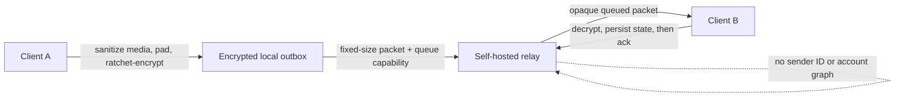

# Устой (Ustoy)

Устой is a self-hostable, privacy-focused messenger prototype. It uses a Rust
cryptographic core compiled to WebAssembly, a local encrypted browser vault, and
a stateless in-memory relay. It has no phone, email, account, or global user ID.
The project is **not independently audited and is not yet a production-secure
messenger**; see the [threat model](docs/threat-model.md) and [audit status](#independent-audit).

## Architecture

```text
crypto-core/             Hybrid handshake, SAS, Double Ratchet, padding, backups
crypto-wasm/             wasm-bindgen API used by the browser client
relay-server/            Rust/Axum capability queues, TTL, rate limits, CORS
client-app/              React live client, encrypted IndexedDB, retry outbox
deploy/                  Caddy reverse proxy and optional Tor onion/SOCKS service
docker-compose.prod.yml  One-command self-hosted deployment
docker-reproducible/     Pinned Rust build environment
docs/                    Protocol, threat model, deployment and operations
```



The sender persists the encrypted packet and the advanced ratchet snapshot
atomically before attempting delivery. Retries reuse that exact ciphertext and
a stable idempotency token; they never advance the ratchet again. The relay's
short-lived deduplication cache is scoped to one destination queue. Relay
acceptance is not a recipient delivery receipt.

## Quick start

Requirements: the pinned Rust toolchain, `cc`/build tools, Node.js 22, `wasm-pack`
0.13.1, Docker Engine, and the Compose plugin.

```sh
cp .env.example .env
make run
```

Open the address configured by `USTOY_HOSTNAME` (default: `http://localhost`).
For a public host, set `USTOY_HOSTNAME` to a DNS name, `USTOY_BIND=0.0.0.0`,
point DNS at the server, and permit inbound ports 80/443. Caddy obtains TLS
certificates for a public hostname. The relay itself is not published directly.
See [`docs/deployment.md`](docs/deployment.md) for Ubuntu/Debian, Tor, binary,
and SHA-256 verification instructions.

To start the optional Tor hidden service and loopback SOCKS5 endpoint:

```sh
USTOY_TOR=1 make run
docker compose -f docker-compose.prod.yml --profile tor exec tor \
  cat /var/lib/tor/ustoy-hidden/hostname
```

The browser's `fetch` API does not use SOCKS5 settings directly. Use a
Tor-configured browser for the onion URL or a native transport that supports
SOCKS5; the live client reports this limitation rather than claiming an
unverified proxy is active.

### Local development and demo

The non-cryptographic UI demo runs with `cd client-app && npm ci && npm run dev`.
It is a visual prototype and must not be used for confidential messages.

To use the Rust/Wasm live client during development:

```sh
make build-wasm
docker compose up --build relay
cd client-app && npm ci && npm run dev
```

The live client uses the Vite `/v1` and `/health` proxy to the local relay.
`make verify` runs formatting, Clippy, Rust/UI tests, Wasm/UI builds, and two
independent release builds with SHA-256 comparisons; it also prints a pass/fail
report if a local prerequisite is missing.

## Security guarantees and limits

| Area | Intended guarantee | Important limit |
|---|---|---|
| Session identity | Independent random queue capabilities; no account or sender ID | Relay sees each queue's activity and the client's network address unless routed through Tor |
| Handshake | X25519 + ML-KEM-768 and a 48-bit SAS | Until people manually compare and confirm SAS/QR, the session is `UNVERIFIED` and active MITM is possible |
| Messages | Per-message Double Ratchet with ChaCha20-Poly1305 | A compromised endpoint can read plaintext and keys |
| Traffic size | Fixed padding buckets | Timing, frequency, queue IDs, and bucket choice remain observable |
| Images | JPEG/PNG re-encoding before encryption removes container metadata | Other formats are rejected; re-encoding is not a defense against malicious files or a compromised codec |
| Local vault | PIN-wrapped random profile key and encrypted IndexedDB records | Browser/OS compromise, keyloggers, memory capture, and browser-managed backups are out of scope |
| Duress | Zeroizes live key material and requires confirmed IndexedDB deletion of the real key wrap before decoy activation | No guarantee of physical SSD/controller, journal, swap, crash-dump, or backup erasure; exported `.ustoy` files remain external copies |
| Relay | Opaque fixed-size packets, bounded in-memory queues and TTL; no application access logs | The relay is not durable; a restart loses queued messages and the network layer can still observe connection metadata |

Full assumptions, assets, attacker capabilities, and non-goals are documented
in [`docs/threat-model.md`](docs/threat-model.md). Wire details are in
[`docs/protocol-v1.md`](docs/protocol-v1.md).

## Independent audit

No independent cryptographic, protocol, application, or deployment audit has
been completed. The included tests and reproducible-build checks are engineering
controls, not an audit or proof of security. Do not rely on Ustoy for safety-
critical, legally sensitive, or high-risk communications until the protocol,
implementations, and operational deployment have received independent review.
